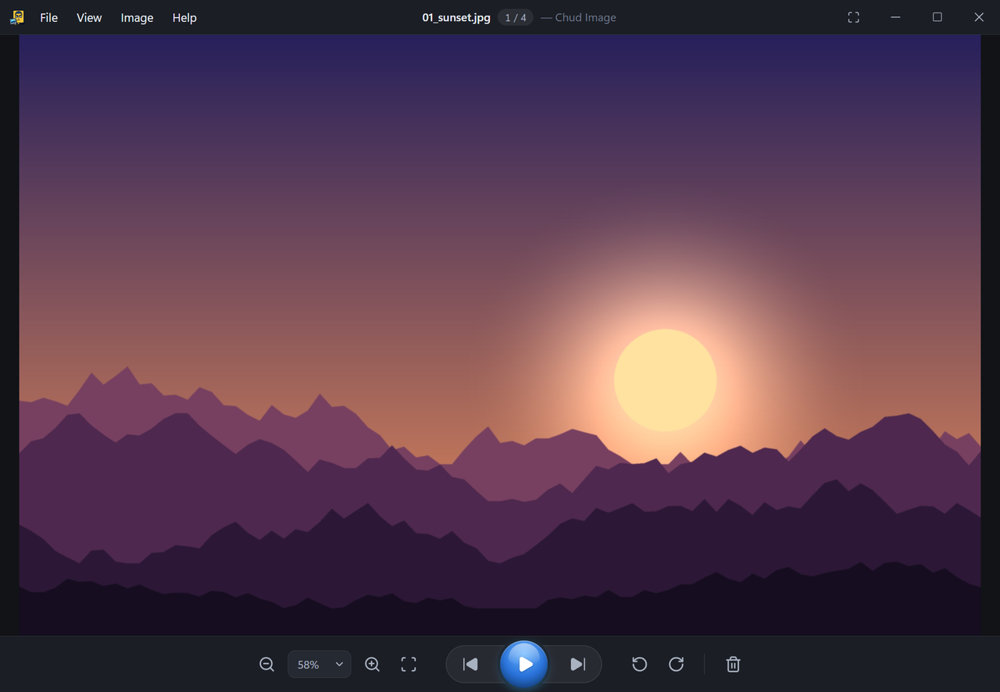
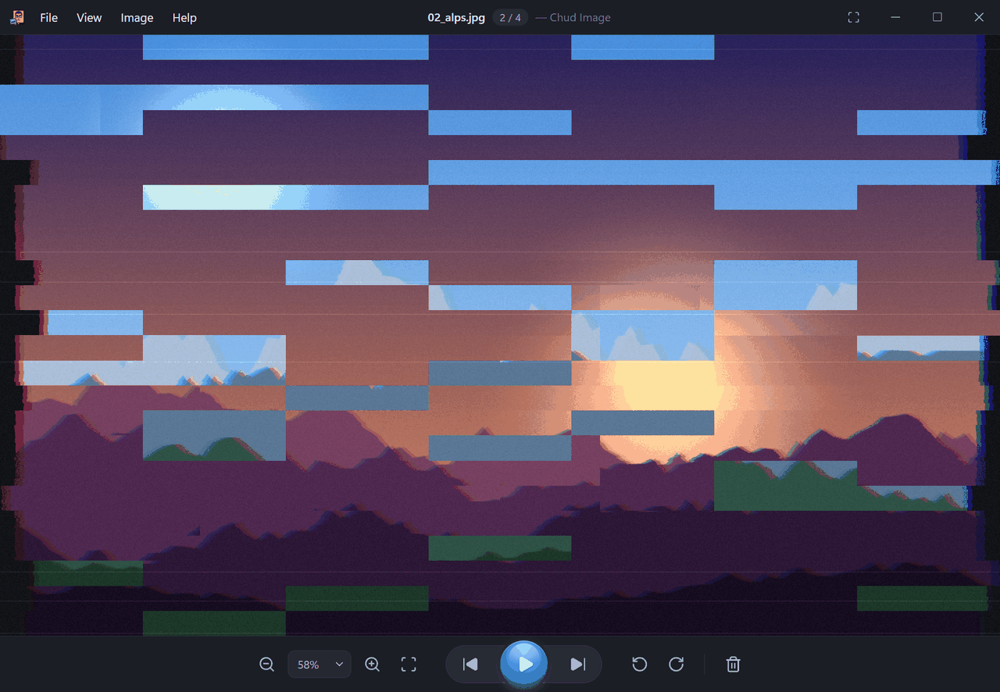
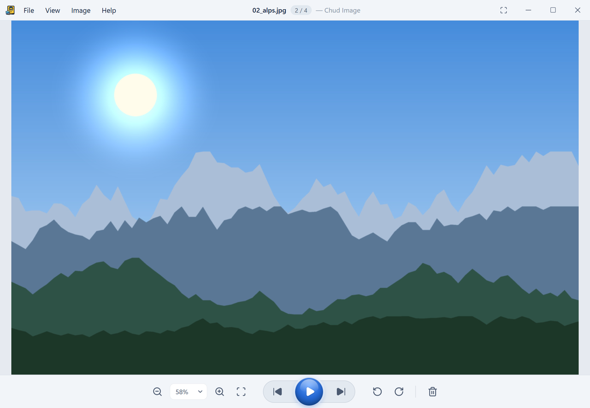
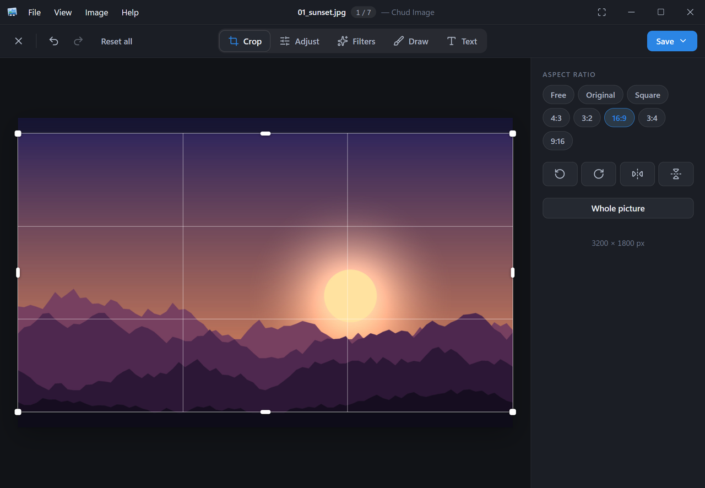
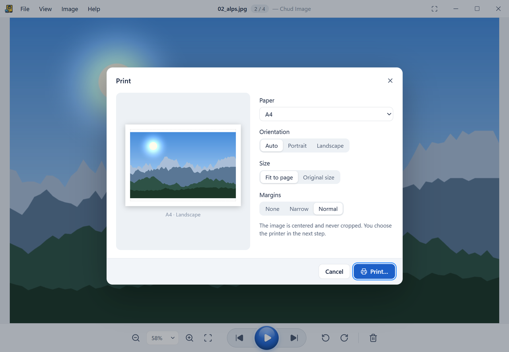
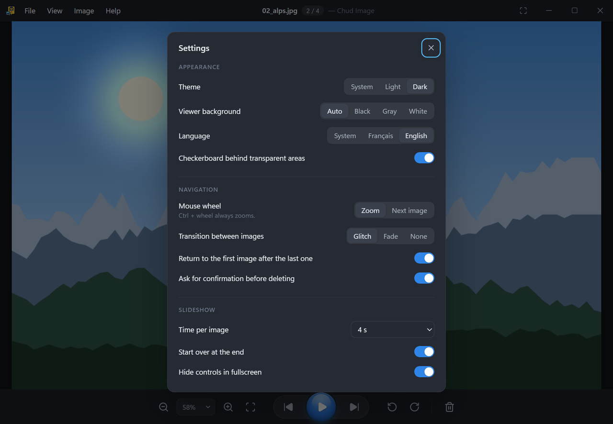

<div align="center">


# Chud Image

**A small, fast desktop photo viewer. Basically the heir of Windows 7 Photo Viewer.**

Open a picture, flick through the folder, zoom, rotate, touch it up, print, done.
No library to import, no account, no cloud.




</div>

---

## Why

Windows 7 Photo Viewer did one thing and did it right: double-click a photo, it opens instantly,
arrows go to the next one, the wheel zooms. Chud Image keeps that exact interaction model
(compact window, big picture, a centered toolbar with the round play button) and rebuilds it
on a modern stack with proper dark mode, real format support and safe file handling.

The old **E-mail** and **Burn** buttons are gone. Nobody misses them.

## Features

| | |
|---|---|
| **Instant browsing** | Opens the file you double-clicked, then lists the rest of its folder in natural order (`IMG_2` before `IMG_10`). Arrows, mouse wheel, Home/End. Neighbours are pre-decoded so the next photo is already there. |
| **Glitch transition** | Moving to the next photo plays a short WebGL glitch: slices tear, RGB channels split, blocks of the new picture bleed through. It can be switched to a fade, or off, in Settings. Respects "reduce motion". |
| **Smooth zoom** | Zoom follows the cursor, with drag to pan, and soft magnets at "fit" and "100%". It runs from 10% of the fit size up to 3200%. Double-click toggles fit / actual size. |
| **Rotation that's safe** | Rotating is a *pending* change until you press `Ctrl+S`. JPEGs are rotated **losslessly** by rewriting the EXIF orientation tag, so pixels are never re-encoded. PNG / BMP / TIFF / WebP-lossless are re-encoded without quality loss after asking. Writes are atomic (temp file + rename). |
| **Quick edits** | `E` opens a simple editor: crop (free or 1:1, 4:3, 16:9…), rotate and mirror, brightness / contrast / saturation / warmth / vignette, one-click filters, pen, highlighter, lines, arrows, boxes, circles and text (with an optional outline). Everything can be undone. Save a copy under a new name, or replace the original, which then goes to the Recycle Bin / Trash so nothing is lost. |
| **Background removal** | Optional, in the editor. Cuts out the subject with an adjustable threshold and saves it with transparency (PNG/WebP/TIFF). It uses an AI model that is **not** shipped with the app: one click downloads it once (BiRefNet lite, 224 MB, MIT license, checked against a SHA-256), and it then runs entirely on your computer. Pictures are never uploaded. The model can be deleted from the same panel. |
| **Slideshow** | `F5` or the play orb. Fullscreen, configurable interval, optional loop, `Esc` to leave. |
| **Fullscreen** | `F11`. The toolbar floats and hides itself along with the cursor. |
| **Real printing** | A preview with paper size (A4, Letter, Legal, A3, A5, 10×15, 13×18), orientation, fit-to-page or original size, and margins. The image is centered and never cropped. |
| **Properties** | `Alt+Enter`. Shows file info, dimensions, DPI, camera, lens, exposure, GPS and the full EXIF list. |
| **Delete** | `Del` sends the file to the Recycle Bin / Trash. If there is no trash, it asks again before deleting permanently. |
| **Themes** | System (default), Light, Dark. The interface changes color; the photo is never tinted. |
| **Languages** | Français and English, following the system by default. |
| **Updates** | Checks GitHub for a new version at startup (can be turned off in Settings) and shows a small badge in the title bar. One click downloads, verifies the signature, installs and restarts. On Linux this works with the AppImage; `.deb` / `.rpm` users get a link to the new package. |
| **Folder changes** | Files deleted or added behind its back are noticed when the window gets focus again. |

<p align="center">
  
  
</p>
<p align="center">
  
</p>
<p align="center">
  
  
</p>

## Supported formats

Chud Image only lists formats it can actually open. If a file can't be decoded you get a clear
message ("damaged", "unsupported", "permission denied"…), never a blank window.

| Format | Windows | Linux | Notes |
|---|:-:|:-:|---|
| JPEG, PNG, GIF (animated), WebP, BMP, ICO | ✅ | ✅ | Decoded by the web engine, colour profiles respected |
| SVG | ✅ | ✅ | Rendered as a picture (scripts disabled) |
| AVIF | ✅ | ⚠️ | On Linux it depends on WebKitGTK being built with AVIF (recent Fedora: yes) |
| TIFF, TGA, QOI, PNM/PBM/PGM/PPM/PAM | ✅ | ✅ | Decoded in Rust, ICC profile kept |
| HEIC / HEIF | ✅¹ | ⚠️² | ¹ Through Windows' codec ("HEIF Image Extensions"). ² Build with `--features heif` and `libheif` installed |
| Camera RAW (DNG, CR2, CR3, NEF, ARW, ORF, RW2, RAF, PEF…) | ✅³ | ✅³ | ³ Shows the full-size JPEG preview embedded by the camera. On Windows, the system RAW codec is used when the preview is small |
| JPEG XL, DDS, JXR… | ✅⁴ | ❌ | ⁴ Any extra codec installed in Windows (WIC) is picked up automatically |

The exact list available on your machine is shown in **Help → About**.

**Rotation & saving:** lossless for JPEG. Re-encoded for PNG, BMP, TIFF, lossless WebP,
single-frame GIF, TGA, QOI and PNM. RAW, HEIC, AVIF, SVG and animated files can be rotated on
screen but are never rewritten.

## Keyboard shortcuts

| Key | Action |
|---|---|
| `←` / `→` | Previous / next image |
| `Home` / `End` | First / last image |
| Mouse wheel | Zoom (or next/previous, see Settings). `Ctrl` + wheel always zooms |
| `+` / `-` | Zoom in / out |
| `Ctrl+0` | Fit to window |
| `Ctrl+1` | Actual size (100%) |
| Double-click | Toggle fit / actual size |
| `R` / `Shift+R` (or `Ctrl+.` / `Ctrl+,`) | Rotate clockwise / counter-clockwise |
| `Ctrl+S` / `Ctrl+Shift+S` | Save rotation / Save as |
| `E` | Edit (crop, adjust, filters, draw, text, background) |
| `Ctrl+Z` / `Ctrl+Y` | Undo / redo, in the editor |
| `Del` | Move to Recycle Bin |
| `F5` | Start slideshow |
| `Space` | Next image, or pause / resume during a slideshow |
| `F11` | Fullscreen |
| `Esc` | Leave slideshow or fullscreen |
| `Ctrl+O` / `Ctrl+Shift+O` | Open image / open folder |
| `Ctrl+P` | Print |
| `Ctrl+C` | Copy image |
| `Alt+Enter` | Properties |
| `F1` | Shortcut list |

## Install

Grab the latest build from the [Releases](https://github.com/BigFatDeuce/Chud-Image/releases)
page, or build it yourself (see below).

- **Windows 10/11:** `Chud Image_x.y.z_x64-setup.exe` (per-user install, no admin needed) or the `.msi`.
  To make it your default viewer: right-click a photo → *Open with* → *Choose another app* → Chud Image → *Always*.
- **Fedora:** `sudo dnf install ./chud-image-x.y.z-1.x86_64.rpm`
- **Debian / Ubuntu:** `sudo apt install ./chud-image_x.y.z_amd64.deb`
- **Anything else:** the `.AppImage`.

## Build from source

You need [Node.js](https://nodejs.org) 20+ and [Rust](https://rustup.rs) (stable).

**Linux** also needs the WebKitGTK toolchain:

```bash
# Fedora
sudo dnf install webkit2gtk4.1-devel openssl-devel curl wget file libappindicator-gtk3-devel librsvg2-devel
# optional, for HEIC support
sudo dnf install libheif-devel
```

```bash
# Debian / Ubuntu
sudo apt install libwebkit2gtk-4.1-dev build-essential curl wget file libssl-dev libayatana-appindicator3-dev librsvg2-dev
```

**Windows** needs the "Desktop development with C++" workload of Visual Studio Build Tools.
WebView2 is already part of Windows 10/11.

Then:

```bash
npm install
npm run tauri dev          # run in development
npm run tauri build        # build installers into src-tauri/target/release/bundle
```

On Linux, add HEIC support with:

```bash
npm run tauri build -- --features heif
```

### Tests

```bash
npm test                                      # zoom math, navigation, shortcuts, editor geometry and colour
cargo test --manifest-path src-tauri/Cargo.toml   # decoding, natural sort, lossless rotation, edit saving, deletion, settings
```

## How it's built

- **Backend: Rust + [Tauri 2](https://tauri.app).**
  - Images are served to the window through a custom `chud://` protocol.
  - Formats the web engine understands are passed through untouched.
  - Everything else (TIFF, RAW previews, HEIC, WIC codecs) is decoded in Rust on a worker thread and sent as a fast PNG.
  - Decoded images are kept in a 384 MB LRU cache.
- **Frontend: React + TypeScript.**
  - The viewer is a small imperative engine outside of React, so zoom and pan never trigger a re-render.
  - The glitch transition is a single WebGL2 fragment shader.
  - The editor keeps a list of edits (never touching the file) and renders them at full size only when you save; the backend re-encodes to the target format and keeps the original EXIF data.
- **Background removal:** [BiRefNet](https://github.com/ZhengPeng7/BiRefNet) (ONNX export from [rembg](https://github.com/danielgatis/rembg)) run with [ONNX Runtime](https://onnxruntime.ai) through the `ort` crate, telemetry off. The model is stored in `%LOCALAPPDATA%\com.bigfatdeuce.chudimage\models` (Windows) or `~/.local/share/com.bigfatdeuce.chudimage/models` (Linux).
- **Updates:** `tauri-plugin-updater` with a signed `latest.json` attached to each GitHub release.
- **Lossless JPEG rotation:** only the EXIF `Orientation` tag is changed. If the file has no EXIF block, a minimal one is inserted. Image data is never touched.
- **Settings** live in a JSON file in your config folder:
  - `%APPDATA%\com.bigfatdeuce.chudimage` on Windows.
  - `~/.config/com.bigfatdeuce.chudimage` on Linux.

```
src/                React UI
  viewer/engine.ts  zoom / pan / rotation / transitions
  viewer/glitch.ts  WebGL glitch transition
  editor/           crop / adjust / draw editor
  lib/              zoom math, navigation, shortcuts, i18n, printing, updater
src-tauri/src/      Rust backend
  decode.rs         display pipeline + cache
  folder.rs         folder listing + natural sort
  jpeg_orient.rs    lossless EXIF orientation editing
  rotate.rs         saving rotations safely
  edit.rs           saving edited pictures (copy or replace)
  bgremove.rs       optional background-removal model (download + inference)
  raw.rs, wic.rs    RAW previews, Windows Imaging Component
  metadata.rs       properties dialog
```

## Credits

The Chud Image icon in `assets/chud-image-icon` belongs to its author and is used as is.
Built with Tauri, React, the `image` crate, `kamadak-exif`, `trash` and ONNX Runtime.
The optional background-removal model is BiRefNet by Zheng Peng et al. (MIT), downloaded on request.
